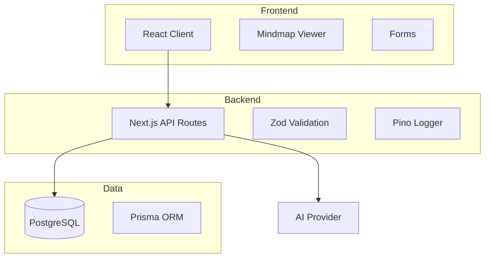

# Architecture

## System Overview



## Directory Structure

```
ideabank/
├── src/
│   ├── app/              # Next.js App Router
│   │   ├── api/          # API routes
│   │   │   ├── health/   # Health check
│   │   │   ├── ideas/    # Idea CRUD
│   │   │   ├── connections/
│   │   │   ├── tags/
│   │   │   └── mindmap/
│   │   ├── layout.tsx    # Root layout
│   │   └── page.tsx      # Home page
│   └── lib/              # Shared utilities
│       ├── prisma.ts     # Prisma client singleton
│       ├── validate.ts   # Zod schemas
│       ├── errors.ts     # Error handling
│       └── logger.ts     # Pino logging
├── prisma/
│   ├── schema.prisma     # Database schema
│   └── seed.ts           # Seed script
├── docs/                 # Documentation
├── .github/              # CI/CD, templates
└── docker-compose.yml    # Local dev
```

## Data Flow

### Creating an Idea

```
1. Client POST /api/ideas
2. Validate with Zod schema
3. Insert into PostgreSQL via Prisma
4. Return created idea as JSON
```

### Fetching Mindmap

```
1. Client GET /api/mindmap
2. Query all ideas and connections
3. Transform to nodes/edges format
4. Return graph structure
```

## Design Decisions

### Why Next.js App Router?

- Server components reduce client JS
- Built-in API routes
- File-based routing
- Strong TypeScript support

### Why PostgreSQL?

- ACID compliance
- JSON support for flexible data
- Strong ecosystem
- Easy deployment (Railway, Supabase)

### Why Zod over Joi?

- TypeScript-first
- Smaller bundle size
- Better inference
- Built-in transforms

## Security

- Input validation on all API routes
- Parameterized queries via Prisma
- Rate limiting (planned)
- CORS configuration (planned)
- Security headers (planned)

## Performance

- Prisma connection pooling
- Response caching (planned)
- Optimistic updates (planned)
- Pagination for large datasets
