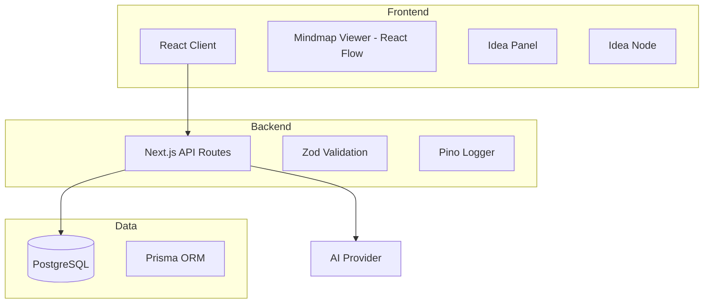

# Architecture

## System Overview



## Directory Structure

```
ideabank/
├── src/
│   ├── app/              # Next.js App Router
│   │   ├── api/          # API routes
│   │   │   ├── health/   # Health check
│   │   │   ├── ideas/    # Idea CRUD
│   │   │   ├── connections/
│   │   │   ├── tags/
│   │   │   └── mindmap/  # Mindmap graph API
│   │   ├── mindmap/      # Mindmap visualization page
│   │   ├── layout.tsx    # Root layout
│   │   └── page.tsx      # Home page
│   ├── components/
│   │   ├── ui/           # Base UI components
│   │   │   ├── Button.tsx
│   │   │   ├── Input.tsx
│   │   │   ├── Textarea.tsx
│   │   │   ├── Modal.tsx
│   │   │   └── Toast.tsx
│   │   └── mindmap/      # Mindmap-specific components
│   │       ├── IdeaNode.tsx      # React Flow node
│   │       ├── IdeaPanel.tsx     # Idea list & CRUD panel
│   │       └── ConnectionModal.tsx
│   ├── store/
│   │   └── mindmap.ts    # Zustand store for mindmap state
│   └── lib/              # Shared utilities
│       ├── prisma.ts     # Prisma client singleton
│       ├── validate.ts   # Zod schemas
│       ├── errors.ts     # Error handling
│       └── logger.ts     # Pino logging
├── prisma/
│   ├── schema.prisma     # Database schema with indexes
│   └── seed.ts           # Seed script
├── docs/                 # Documentation
├── .github/              # CI/CD, templates
├── tailwind.config.js    # Tailwind CSS config
└── docker-compose.yml    # Local dev
```

## Tech Stack Details

| Layer | Technology | Purpose |
|-------|------------|---------|
| UI Framework | Next.js 14 | Full-stack React framework |
| Mindmap | React Flow (@xyflow/react) | Interactive node-based graph |
| State | Zustand | Lightweight state management |
| Styling | Tailwind CSS | Utility-first CSS |
| Database | PostgreSQL + Prisma | ORM with type safety |
| Validation | Zod | Schema validation |
| Logging | Pino | Structured logging |

## Data Flow

### Creating an Idea (via Mindmap UI)

```
1. User fills IdeaPanel form
2. POST /api/ideas with validated data
3. Prisma inserts into PostgreSQL
4. Return created idea
5. Zustand store updates nodes
6. React Flow re-renders graph
```

### Fetching Mindmap

```
1. Client GET /api/mindmap
2. Query all ideas (with tags) and connections
3. Transform to React Flow nodes/edges format
4. Return graph structure
5. Store synced to React Flow state
```

### Creating Connection

```
1. User drags from one node to another
2. ConnectionModal opens for relationship type
3. POST /api/connections
4. Prisma creates connection (with unique constraint)
5. Edge added to Zustand store
6. React Flow renders animated edge
```

## Design Decisions

### Why React Flow?

- Purpose-built for node-based UIs
- Handles edge/node interactions out of the box
- Customizable node rendering
- Built-in zoom, pan, minimap

### Why Zustand over Redux/Context?

- Minimal boilerplate
- No providers needed
- TypeScript-friendly
- Good performance with small-to-medium state

### Why Tailwind CSS?

- Rapid UI development
- Consistent design system
- Small bundle size (purged)
- Easy theming

## API Design

All endpoints return JSON and use consistent error formatting:

```typescript
// Success
{ "id": "...", "title": "...", ... }

// Error
{ "error": "Message", "details": [...] }

// Validation Error
{ "error": "Validation failed", "details": [{ "field": "title", "message": "Required" }] }
```

## Security

- Input validation on all API routes via Zod
- Parameterized queries via Prisma (SQL injection prevention)
- Request ID tracking for audit logs
- CORS configured for same-origin (expand for API consumers)
- Rate limiting (planned for V2)

## Performance

- Database indexes on `Idea.title`, `Idea.createdAt`, `Idea.updatedAt`, `Connection.sourceId`, `Connection.targetId`
- Prisma connection pooling
- React Flow virtualization for large graphs
- Optimistic UI updates

## Scalability Considerations

- Mindmap endpoint loads ALL nodes by default (suitable for <500 nodes)
- For larger graphs: implement viewport-based lazy loading
- Consider WebSocket/SSE for real-time collaboration (V3)
